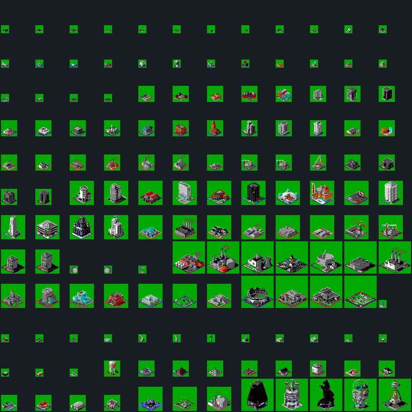
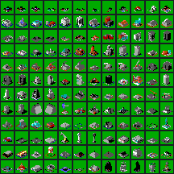
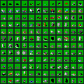

# SimCity 2000 building resources

Converted building artwork in Tandy 8×8 and classic Micropolis 16×16 sizes.
All **144 building IDs, 0x70–0xFF**, are included: houses, apartments,
commercial and industrial buildings, construction/abandoned sites, power
plants, civic services, airport/seaport facilities, arcologies and the dome.
Terrain, roads, bridges and separate animation frames are outside this catalog.

## Downloads and formats

### Footprint-sized libraries (recommended)

The full-size exports preserve proposed square footprints: **47 at 1×1,
47 at 2×2, 34 at 3×3 and 16 at 4×4**. Original sprite widths of 32, 64,
96 and 128 pixels supply the footprint classification. This matches the
RCI category sizes and gives large power plants, stadiums and arcologies
4×4 target lots. These are artwork footprints, not new simulation registrations.

| File | Contents | Bytes |
|---|---|---:|
| [SC2KM8.DAT](SC2KM8.DAT) | 797 packed 8×8 tiles across 144 buildings | 25,504 |
| [SC2KM16.DAT](SC2KM16.DAT) | 797 packed 16×16 tiles across 144 buildings | 102,016 |
| [sc2k-multi-16.xpm](sc2k-multi-16.xpm) | Classic 16×12752 vertical tile strip | text |
| [sc2k-multi-8.xpm](sc2k-multi-8.xpm) | Tandy 8×6376 vertical tile strip | text |
| [footprints.json](footprints.json) | Footprints, first tile, tile count, byte offsets and lengths | JSON |
| [FOOTPRINTS.md](FOOTPRINTS.md) | Human-readable footprint index | Markdown |

For example a 3×3 factory uses a 24×24 Tandy or 48×48 classic canvas,
split into nine tiles. A 4×4 facility gets 32×32 or 64×64 pixels.
Buildings appear in ascending SC2000 ID order; tiles within a building
are ordered left-to-right, then top-to-bottom. Pixels within each tile
remain row-major, 4bpp, high nibble first. Find the first tile and offsets
in `footprints.json`; **do not use `(ID-0x70)*stride`** for these libraries.
Subtile `(x,y)` starts at `offset + (y*footprint_width+x)*tile_bytes`.

The complete building is resized once, then split. Only the outer canvas
gets a one-pixel margin; internal tile edges have no padding or zone borders.
To reconstruct, place the pieces into their metadata-defined square footprint.
The 16px DAT exceeds 64KB: a future 16-bit consumer must use file seeks or
banked buffers and 32-bit offsets rather than a single 16-bit-sized allocation.
Checksums are in `SHA256SUMS-FOOTPRINTS`.

These packs do not replace `TILES.DAT` or the 12-building `SC2K.DAT`.
The Tandy DOS runtime now displays full 2×2/3×3 RCI buildings and
supports growth, demolition and separate, validated .NBL footprint
records. The original .CTY tile IDs and the existing 1×1 C/I data
are unchanged. 4×4 facility/arcology gameplay remains future work.



The sheet uses equal 4×4-lot cells to show relative sizes; buildings are
bottom-left aligned, in ascending ID order. Empty space around smaller lots
belongs only to the contact sheet, not to their stored tile records.

### Legacy 1×1 thumbnails and runtime pack

The initial all-building thumbnail libraries remain available for previews
and existing consumers. Use the multi-tile libraries above for larger art.

| File | Contents | Bytes |
|---|---|---:|
| [SC2K8.DAT](SC2K8.DAT) | 144 raw 8×8 tiles, 32 bytes each | 4,608 |
| [SC2K16.DAT](SC2K16.DAT) | 144 raw 16×16 tiles, 128 bytes each | 18,432 |
| [sc2k-16.xpm](sc2k-16.xpm) | Classic-size XPM vertical strip, 16×2304 pixels | text |
| [sc2k-8.xpm](sc2k-8.xpm) | Tandy-size XPM vertical strip, 8×1152 pixels | text |
| [SC2K.DAT](SC2K.DAT) | Current game's optional 12-building small-lot pack | 392 |
| [catalog.json](catalog.json) | Names, categories, source dimensions, offsets and palette | JSON |
| [CATALOG.md](CATALOG.md) | Human-readable index of every building | Markdown |

Use GitHub's **Raw / Download raw file** action for binary downloads.
The two complete DAT libraries have no header: pixels are row-major,
two 4-bit palette indices per byte, left pixel in the high nibble.
Record `i` represents SC2000 ID `0x70 + i`; byte offsets are `i*32` and
`i*128`. The palette is the 16-colour IBM PC/Tandy palette listed in
`catalog.json` and embedded in the XPMs. SHA256SUMS verifies generated files.

**The full libraries are not replacements for the original TILES.DAT.**
Their IDs and counts differ from Micropolis's 960-tile atlas. The legacy 16×16 XPM
is a classic-size artwork library, not a plug-and-play SimCity Classic game
file: The Tandy DOS implementation now composes complete 2×2 and 3×3 RCI
footprints in a sidecar overlay; assigning original CTY gameplay IDs
remains explicitly out of scope. Each source building is fitted into one icon, including
buildings whose original footprint is 2×2, 3×3 or larger.

## Using the current integration

For the DOS build, the public runtime filenames are now
`NEWER1.DAT` (an exact copy of the unchanged 1×1 pack) and
`NEWERM8.DAT` (the full 797-tile footprint library). The legacy
`SC2K.DAT` remains accepted for existing installations. The archival
conversion directory below uses historical source names to preserve
accurate provenance and reproducibility; its documented origin is not
a claim of copyright ownership.


Copy `NEWER1.DAT` and `NEWERM8.DAT` beside the newly built `MICROPOL.EXE` and the original `TILES.DAT`. The archived `SC2K.DAT` is no longer packaged under its old filename.
Developed custom 1×1 commercial/industrial lots use eight commercial and
four industrial sprites. Density stages choose groups of sprites; world
coordinates choose repeatable variants. Original residential sprites,
authentic larger buildings, growth rules, jobs, power, and CTY/ZON saves
remain unchanged. Remove the optional pack to use the original fallback.
The Tandy CI release includes this optional pack beside the normal art.

## Reproducing the conversion

Use the Windows 95 Special Edition files from a local installation:
`WIN95/SC2K/DATA/LARGE.DAT` and `WIN95/SC2K/BITMAPS/PAL_MSTR.BMP`.
The disc's top-level DATA directory contains videos and is not the source.
No dependencies beyond Python's standard library are needed.

```sh
python3 tandy-dos/tools/convert_sc2k_buildings.py /path/to/WIN95/SC2K resources/sc2k-buildings
python3 tandy-dos/tests/test_sc2k_converter.py
python3 tandy-dos/tests/test_sc2k_resources.py
```

1. Read the big-endian sprite index: count, ID, absolute offset, height, width.
   The building sprite ID is the SC2000 map ID plus 1000. For duplicate
   IDs choose the largest image (ties keep index order). Some tiny
   placeholders precede their complete sprite: the B7 office tower has
   a 96×5 placeholder followed by the real 96×117 image.
2. Decode rows and runs: row markers, transparent skips, palette-index
   pixel runs, odd-run padding and sprite terminators. Reject invalid
   offsets, dimensions and runs before reading outside the sprite.
3. Read the BMP's BGR palette and map colours to the nearest Tandy RGB value.
4. Preserve aspect ratio and fit inside the footprint-sized canvas minus
   a one-pixel outer margin (6×6 or 14×14 for a 1×1). Reserve a
   one-pixel border, bottom-align, and vote among opaque target-palette
   colours within each source area. Require at least 25% opaque coverage.
5. Fill transparency with green ground (palette index 2), split each larger
   canvas into row-major map tiles, pack the pixels,
   and emit raw DAT files, XPM strips, contact sheets, catalog and hashes.

The process is deterministic. Source-file hashes are recorded in the catalog;
source game archives and local filesystem paths are not included.

## Results and limitations

The initial experiment extracted 12 small C/I buildings at their original
size and compared 16×16 reductions. The Tandy renderer actually uses 8×8
tiles, so its final pack was reduced directly from the original sprites.
Low shops and warehouses retain useful silhouettes; towers and large
facilities lose detail. These are direct reductions, not hand-redrawn
top-down art: the isometric perspective and source lot outlines remain.

The DOS executable compiled with Open Watcom (`-0 -ml -bcl=dos`). Loader,
converter and existing host regression checks passed. The showcase rendered
in DOSBox 0.74-3 and pause input worked. Full gameplay and real Tandy timing
are not verified. Conversion of the remaining categories makes their art
available; it does not add those buildings to the simulation.

### Classic 16×16 contact sheet

IDs increase left-to-right and then top-to-bottom, starting at 0x70.



### Tandy 8×8 contact sheet



## Provenance

Artwork is derived from Maxis/Electronic Arts SimCity 2000 supplied for this
conversion. It is distinct from the original Micropolis GPL artwork; this
conversion does not assign a new license to the source images.
Converter code follows the repository's GPL-3.0-or-later licensing.
Format and building-index references:
[sprite format](https://github.com/OpenCity2k/SC2k-docs/blob/master/sprite%20data%20spec.md)
and [building IDs](https://github.com/OpenCity2k/SC2k-docs/blob/master/sc2%20file%20spec.md).
